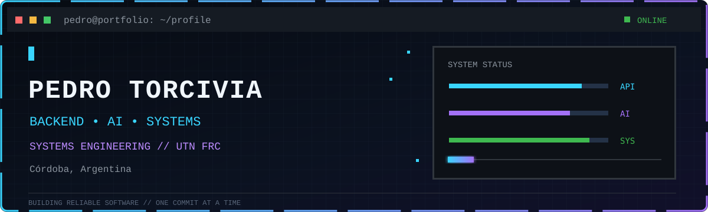
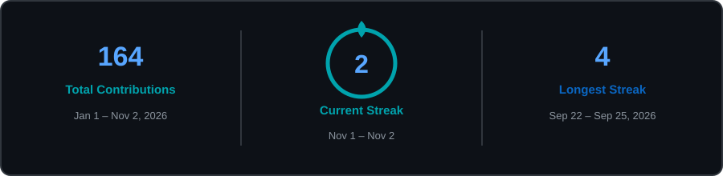

<p align="center">
  
</p>

<p align="center">
  <a href="https://www.linkedin.com/in/pedro-torcivia-4160a6276/"></a>
  <a href="mailto:torcivia.p3dro@gmail.com"></a>
  <a href="https://github.com/pedr0torcivia"></a>
</p>

<p align="center">
  Backend Engineering · Artificial Intelligence · Systems Design
</p>

## About me

```text
NAME       Pedro Torcivia
LOCATION   Córdoba, Argentina
ROLE       Backend AI Engineering Intern @ FlyRank AI
STUDYING   Information Systems Engineering · UTN FRC · 4th year
FOCUS      Backend services · AI-assisted products · simulation · full-stack systems
LANGUAGES  Spanish (native) · English (C1 Cambridge)
```

I enjoy turning complex requirements into reliable software: from domain modelling and APIs to automation, data-driven simulations and usable interfaces. My repositories document both the result and the engineering decisions behind it.

## Current focus

- Building production experience at **FlyRank AI** as a Backend AI Engineering Intern.
- Studying **Information Systems Engineering** at Universidad Tecnológica Nacional — Facultad Regional Córdoba.
- Deepening my work with **Python, Java, TypeScript, React, APIs, Docker and relational databases**.
- Exploring how AI can improve software delivery without losing clarity, testing or maintainability.

## Technical toolkit

<p align="center">
  
  
  
  
  
  
  
  
  
  
</p>

## GitHub activity

<p align="center">
  
</p>

<p align="center">
  
</p>

## Credentials

- **Cambridge English C1 Advanced** — professional working proficiency.
- **Google Data Analytics: Foundations — Data, Data, Everywhere**.
- Academic and personal projects spanning backend architecture, full-stack development, simulation and automation.

## Contact

```text
LinkedIn  linkedin.com/in/pedro-torcivia-4160a6276
GitHub    github.com/pedr0torcivia
Email     torcivia.p3dro@gmail.com
```

<p align="center"><sub>Focused on building clear, reliable and maintainable software.</sub></p>

